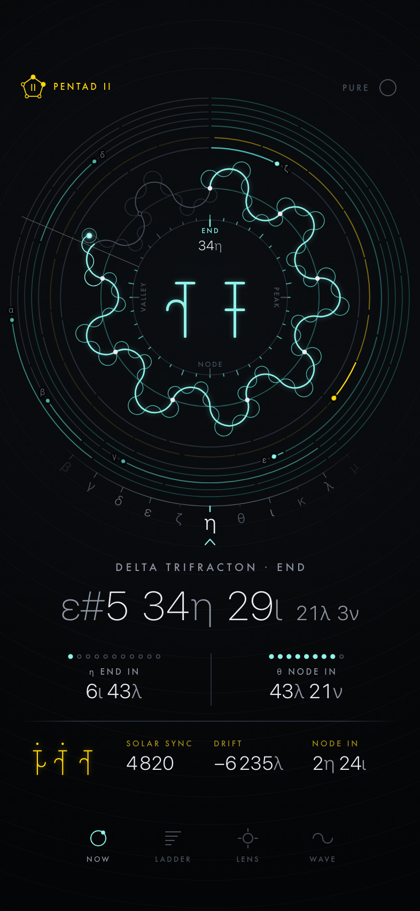
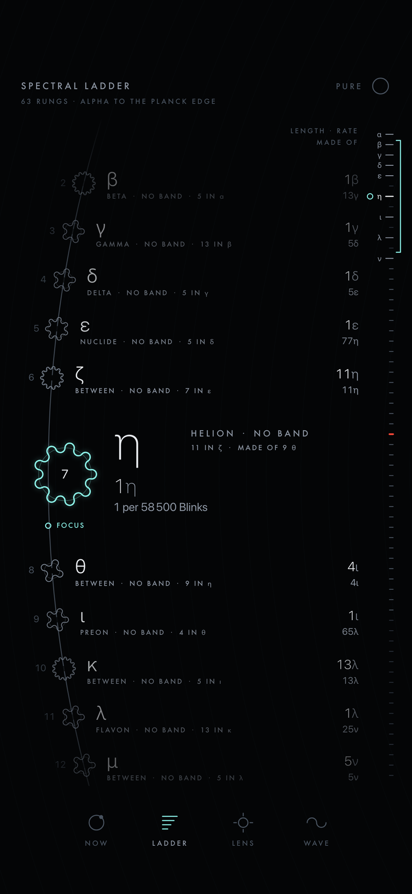
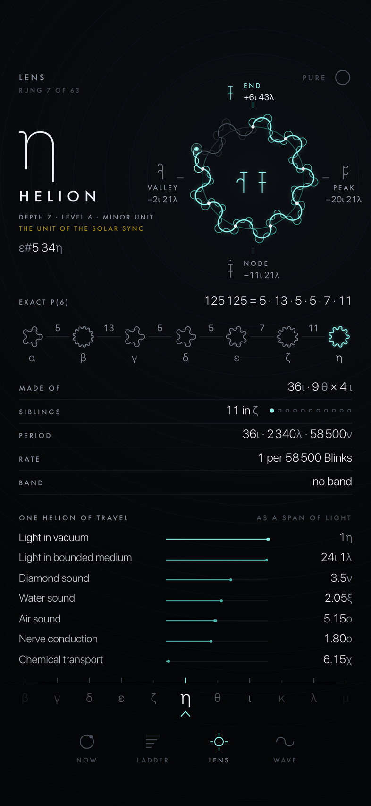
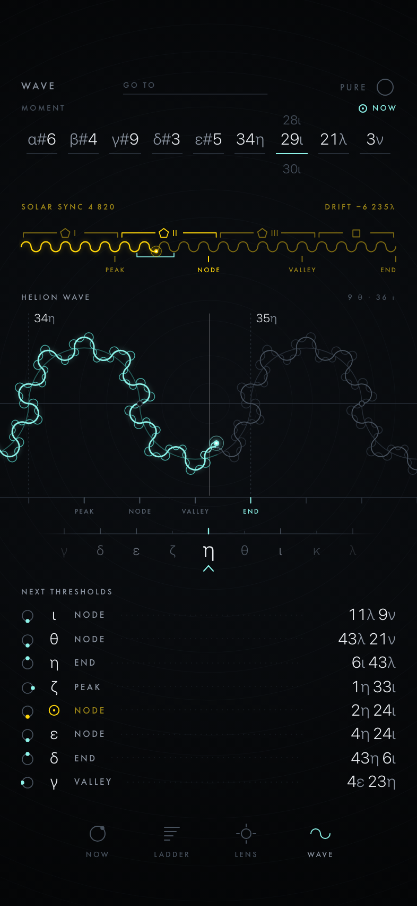
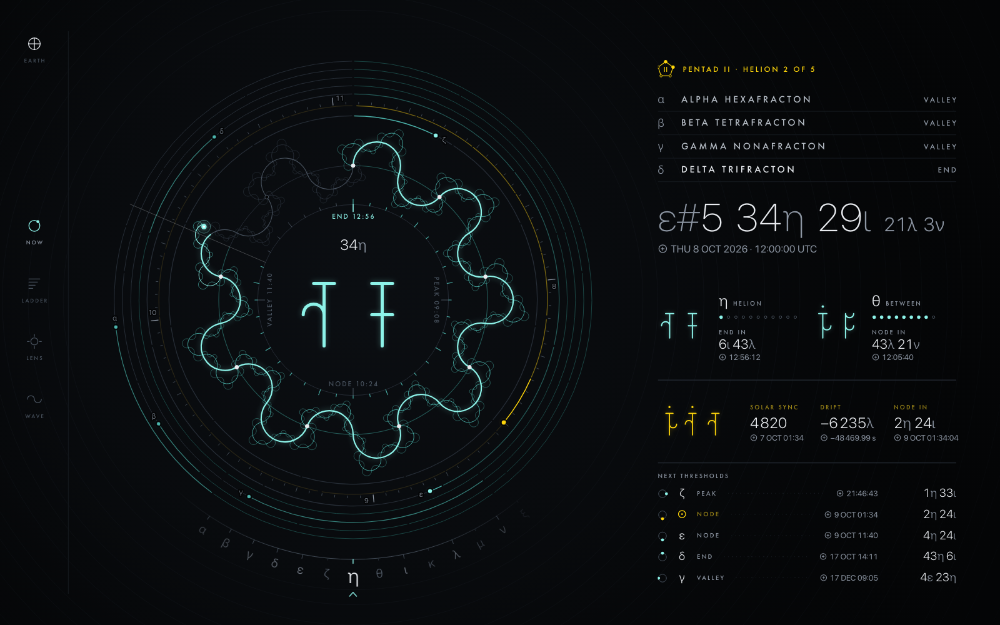

# fractonica-web

The Fractonica clock for the web: an eclipse-anchored harmonic clock, shown as an instrument of nested arcs.

This repository holds three things:

1. **`public/fractonica.wasm`**: the Fractonica core (the C99 library of the sibling repository `core/`) compiled to
   one small WebAssembly module. It is the single source of every number, name, boundary and text the clock shows.
2. **`public/lib/fractonica.js`**: the JavaScript binding of that module, usable on its own in browsers and in Node.
3. **`public/app/`**: the clock app (screens NOW, LADDER, LENS, WAVE; modes PURE and EARTH).

| | | | |
|---|---|---|---|
|  |  |  |  |
| NOW | LADDER | LENS | WAVE |



All pictures are at the specification's test vector A (2026-10-08T12:00:00Z); more in [`docs/screens/`](docs/screens/)
(EARTH mode, the desktop arrangement of every screen, another focus, the out-of-catalogue state, the Basalt theme).

There are **no dependencies**: no npm packages, no bundler, no framework, no web fonts, no CDN. The site is plain
ES modules, HTML and CSS, served as static files. Node 22 or later (24 is what it is tested on) is needed only for
the tools and the tests: `make test` passes its quoted glob to `node --test` (Node 21+), and the browser tools use
the global `WebSocket` (Node 22+).

## Quick start

```sh
make serve          # http://127.0.0.1:8141/   (PORT=9000 make serve for another port)
make test           # every test suite
make shoot          # screenshots of every screen, layout and mode into build/shots/ (needs Google Chrome)
```

Nothing has to be built first: the WebAssembly module is kept in the repository.

## Hosting

`public/` is the whole site. Copy it to any static host, at the root or under any sub-path (`/fractonica/`,
`https://<user>.github.io/<repository>/`): every URL in it is relative. The host must serve `.wasm` as
`application/wasm` (all common ones do; `tools/serve.mjs` does) and `.webmanifest` as `application/manifest+json`.
`index.html` opened straight from the disk (`file://`) does not run: browsers refuse module scripts on such a page
(Chrome says so in its console); the page then says to serve it.

Once opened, the site keeps working without a network: everything it needs is loaded with the page, and a small
service worker (`public/sw.js`, network first, its cache only as the fallback) lets it open again offline.
It installs as an app (web manifest, icons in `public/icons/`, drawn from the instrument's own geometry).

A frozen, repeatable view: `http://127.0.0.1:8141/?t=1791460800` (2026-10-08T12:00:00Z, the specification's test
vector A).

## The app

One instrument, drawn on circles: the focused cycle is a ring of nested, alternating half-cycle arcs; light means
elapsed. Around it one plain ring per coarser level (each with its "planet"), the Sun's ring of 19 Helions, and under
it the limb: the scale of levels.

| | |
|---|---|
| Screens | **NOW**, **LADDER**, **LENS**, **WAVE**: the four sigils, bottom centre on a phone, in the left rail on a desktop |
| The catalogue | LADDER: all 63 rungs on the rim of a great wheel. Drag it, roll the wheel, ↑ / ↓, Page Up / Down, Home / End, or press on the spine at the right edge (the whole ladder in 63 ticks). The large row opens the LENS (click, Enter); a long press, a double click, F, or the FOCUS mark under the large seal puts the instrument's focus on a rung (levels 0 to 13) |
| One rung | LENS: name, kind, the lineage of seals from the Alpha with the factors between (click one to go there), what it is made of, its period in every finer unit, its rate, its band, one cycle of travel in seven media; for the 14 levels the instrument can show, a live ring with the four thresholds as signed spans. The limb at the bottom runs over all 63 rungs; Escape or a swipe down goes back |
| The timeline | WAVE (the screen's heading reads WAVE): time moves under a fixed hairline. The focused level's cycles lie along a line as the same nested arcs, lit up to the hairline; above it the Sun's lane (one solar sync: 19 Helions, four Pentads); below it the four thresholds of the cycle and the list of what comes next across the levels. **Drag the wave** to scrub (it coasts, and stops exactly on a threshold when released within 6 px of one); drag or click the Sun's lane for coarse moves; turn a **tumbler** of the stamp (drag up / down, the wheel, ↑ / ↓) to step one term by whole units; type a date into **GO TO** (any form the core writes, or short: `35η`, `a#7 b#2`; in EARTH mode also `2026-10-08 12:00`). The limb changes the scale of the wave. NOW is lit while the present is shown |
| Modes | **PURE**: only Fractonica units, everywhere (labels for screen readers and the page title included). **EARTH**: adds the Gregorian translation, each line led by ⊕ (a column that is all Earth carries one ⊕ in its heading), in the browser's time zone: periods, frequencies and lengths in metres on the ladder and the lens, clock times at the thresholds, the date-time line of the timeline (its six fields are tumblers too) |
| Across the scales | drag the limb, tap a letter, ← / →, the wheel or a pinch on the instrument; 14 levels, Alpha (72 years) to ξ (44 ms) |
| Into a level | click the centre of the instrument: the LENS opens on the focus; Escape goes back |
| Through time | on the WAVE (above). The cursor is shared by all screens: the instrument, the ladder and the lens show the scrubbed moment; away from the present a NOW mark shows the distance as a span (`+3η 12ι`) and returns (Escape too). Time travel stops at the catalogue's edges |
| Layouts | phone below 700 px of width, desktop above; both scale (small phones, tablets, very wide windows, rotation) |
| Themes | Astrolabe (obsidian and one cold light) and Basalt (`?theme=basalt`: warm stone, bone, gold) |

The address bar is always a deep link:

```
?t=<unix seconds>      freeze the present at an instant (repeatable pictures)
&at=<unix seconds>     the cursor: a moment looked at instead of the present
                       (both may carry a fraction to the microsecond: at=1791460800.3125)
&mode=pure|earth       &screen=now|ladder|lens|wave
&focus=<0..13>         the instrument's level (6 = Helion)
&level=<0..62>         the rung the lens inspects and the ladder is turned to
&theme=astrolabe|basalt
```

Mode and focus are remembered (localStorage); a link overrides them. Each change of screen is a step in the
browser's history, so Back (and the Android back gesture) goes back a screen; other changes replace the current
step. The tab reads `Fractonica · δ#3 ε#5 34η 29ι` (the moment to the Preon: it changes every eight minutes or so).

The app never computes the clock. It asks the core, draws what it is told, and sleeps until the instant the core
says something visible changes. The Earth wording is the core's too ("THU 8 OCT 2026 · 12:00:00", "56 min 12 s",
a typed Earth date: `frc_format_civil_text`, `frc_format_duration`, `frc_parse_civil`), as are the band edges of
SPEC 16.2, the instant at a place on the timeline while scrubbing (`frc_time_at_phase`, `frc_time_at_sync_phase`),
signed counts and spans (`−3`, `+18ι 13λ`), the stamp's terms, "8 of 9", "9 θ", "11 in ζ", the prefix with its
factors and the glyph state at a threshold. One small shim is left, in one marked file,
`public/app/model/shim-earth-text.js`: the sync's drift in seconds with hundredths (`−48 469.99 s`) and the plus
in front of an Earth duration ahead (`+5.41 s`), two texts the core does not write yet. Every exact stop (a
threshold, a tumbler step, a typed date) is an instant of the core.

Out of the catalogue (before 1613 or after 2857) the instrument stays engraved, nothing is lit, and the reading
says `OUT OF CATALOGUE · α#1 – α#18`.

## Using the binding

```js
import { load, Unit, DateForm } from './lib/fractonica.js';

const frc = await load();                      // fetches ../fractonica.wasm (reads it from disk in Node)
const cat = frc.saros141;                      // the built-in catalogue, Solar Saros 141
const now = frc.now();                         // an instant: BigInt Unix microseconds

frc.formatDate(cat.dateAt(now), DateForm.LETTERS, Unit.BLINK);   // "α#6 β#4 γ#9 δ#3 ε#5 34η 29ι 21λ 3ν"
const helion = cat.odometerAt(now, 6, 2, 2);   // { digits: [13, 0], nextChange: 1791460833051680n, ... }
// draw helion.digits with frc.glyphFromIndex + frc.glyphSvgPath, redraw at helion.nextChange
```

- Instants are **BigInt microseconds**; "no such instant" is `null`.
- Levels are zero-based (0 is Alpha). Enumerations (`Unit`, `Quarter`, `DateForm`, ...) are exported objects.
- Results are plain frozen objects; every `format...` method returns a string.
- A failure is a `FractonicaError` whose `status` is the core's status name, for example `"FRC_ERR_RANGE"` for an
  instant outside the catalogue (1613 to 2857 for Saros 141).
- The binding does no arithmetic of its own. Types are in `public/lib/fractonica.d.ts`.

The head of `public/lib/fractonica.js` documents the conventions; `AGENTS.md` has the whole API as an outline.

**Embedding the binding alone** (another app, a widget, a Node script): copy two files, keep them side by side,

```
your-site/fractonica.wasm
your-site/lib/fractonica.js        (+ fractonica.d.ts for editors)
```

and `import { load } from './lib/fractonica.js'`. `load()` looks for `../fractonica.wasm` next to the binding; give
it another place (`load('/assets/fractonica.wasm')`, bytes, a `Response` or a compiled `WebAssembly.Module`) when
the layout differs. Nothing of `public/app/` is needed. In Node it reads the file from disk:
`node -e "import('./public/lib/fractonica.js').then(async ({ load }) => console.log((await load()).version))"`.

## The WebAssembly module

| | |
|---|---|
| Size | 55,954 bytes (23,852 gzipped) with core 0.2.0; `make size` prints the current figure |
| Target | wasm32, freestanding: no libc, no WASI, **no imports** (it is instantiated with `{}`) |
| Memory | fixed at 3 pages (192 KiB); it cannot grow |
| Exports | the 119 public `frc_*` functions of `fractonica.h`, the memory, and 36 `frcw_*` helpers of `wasm/glue.c` |

The module is built from the core, a separate repository of the same organisation. The build expects it as a
**sibling checkout** (`../core`, the default) or anywhere else named by `CORE=`; as a git submodule it would be

```sh
git submodule add <core repository URL> core      # then: CORE=core make wasm
```

Only `make wasm`, `make verify-wasm` and the native cross-check (`test/crosscheck.test.js`) need the core; serving,
the app and every other test use the kept module. Rebuilding is only needed when the core or `wasm/glue.c` changes:

```sh
make wasm           # needs clang with the wasm32 target and wasm-ld (Homebrew: llvm + emscripten's wasm-ld)
make verify-wasm    # proves the kept module is byte for byte what the sources build
```

`CORE=/path/to/core make wasm` builds from a core checkout that is not at `../core`. The build script finds a working
clang and wasm-ld by itself (`CLANG=` and `WASM_LD=` override it) and refuses a module that imports anything.

## Tests

`make test` runs the suites of `test/` with `node --test`:

| Suite | What it holds |
|---|---|
| `spec-vectors` | SPEC section 12: vectors A, B, C and the anchor, typed in from the specification |
| `notation` | SPEC section 15.6 and the worked examples of 15.2 to 15.5; the pure-mode wordings |
| `ladder` | SPEC section 16.5 (exact rationals, compared digit for digit) and rows of the 16.1 table |
| `roundtrip` | date ↔ instant, text ↔ date, civil fields ↔ instant, at 400 random instants each |
| `crosscheck` | the module and the binding against a **native build of the core**, byte for byte: about 195,000 lines |
| `layout` | struct layouts and enumerators against the header's text and a typed-in snapshot |
| `module` | no imports, fixed memory, size budget; every header function exported, wrapped and typed |
| `memory` | ten thousand mixed calls leave the memory, the scratch block and the keep block where they were |
| `binding` | errors, argument checks, `null` for "no instant", frozen results, the drawing helpers |
| `serve` | MIME types of the static server; the binding loading over HTTP |
| `app` | the app's model and readings without a browser: URL and store, the token table, where literals and arithmetic may live, what the instrument and NOW read at vector A, geometry for every focus level |
| `catalogue` | what the LADDER and the LENS read, without a browser: a rung's facts, SPEC 16.1's figures, the band rule from the core's edges against its bands, the lens at vector A and on all 63 rungs, the wheel's geometry |
| `browser` | the page in headless Chrome: NOW reads vector A; pure mode leaves no Earth text anywhere; navigation by keys, limb, wheel, pinch; the cursor; out of catalogue; a running clock; a clean console |
| `wave` | the WAVE without a browser: what it reads at vector A (the stamp term by term, the Sun's lane, the list of screen5.png), where a tumbler step, a key and a typed date lead (carries, the catalogue's edges, a step forth and back at 300 instants), the scrub (the core's instant at a phase) read back through the core, the wave's half-cycle bookkeeping and the geometry of a cell |
| `browser-wave` | WAVE in headless Chrome: the positions of the design, scrubbing by pointer (direct, snapping, coasting, none under reduced motion), tumblers by key, drag and wheel, GO TO, the Sun's lane, the scrubbed moment on every screen, pure and Earth at every scale, the desktop arrangement, repaint rates |
| `browser-journey` | one user's journey in headless Chrome (limb, mode, every screen, a tumbler, a scrub, back to NOW, the keyboard) with every figure held against the core asked in Node at vectors A, B and C; the clock running live; an idle NOW page measured with Chrome's Performance domain |
| `browser-hosting` | the site under a sub-path (every request relative and answered) and offline (every screen with the network off; a reload served by the service worker) |
| `browser-firefox` | the second engine: every screen, layout and mode in headless Firefox (WebDriver BiDi), keyboard and toggle |
| `zones` | EARTH mode in zones off UTC (Kolkata, New York, St John's, Chatham, Lord Howe), one process per zone: the date line, the zone named in English under any language, the civil hour ticks of the Sun's ring against the platform's own clock across changes of offset |
| `browser-device` | the page as a device in a hand: touch targets of 44 px, no text selection but the reading, Back between screens, a link that brings the same Blink back, `?t=` beyond a JavaScript Date, a wall clock set back, EARTH mode in three zones and a German browser, GO TO's messages, the title, named Tab stops; a clean console everywhere (so no Content-Security-Policy violation) |
| `browser-catalogue` | LADDER and LENS in headless Chrome: rows and positions of the design, turning the wheel, the spine, opening the lens, focusing the instrument, the limb over 63 rungs, swipe down, pure and Earth at every kind of rung |

The cross-check compiles a small C program with the host `cc` and needs the core checkout; the browser suites
need Google Chrome (`CHROME=` names another binary), the Firefox suite Firefox (`FIREFOX=`). A suite whose tool is
missing is skipped and says why.

Beyond the tests: `make shoot` (pictures at the design's two viewports), `make audit` (every screen at phones from
320 px, a phone on its side, tablets, 1920 px, 200 % zoom and reduced motion, checked for text cut by the window's
edge or its box, type under 6.2 px, and a scrolling box without its fade), `make idle` (what a live page costs the
main thread: the Helion, and the finest foci on a desktop).

Node 22 or later runs them (24 is what they are tested on).

## Layout

```
Makefile, package.json   commands; package.json only says "these .js files are ES modules"
wasm/                    glue.c, build.sh, check-module.mjs, exports.txt
public/                  the site root, served as it is
  fractonica.wasm        the built module (kept in the repository)
  lib/                   fractonica.js, fractonica.d.ts
  index.html, styles/    the page and its layout: app.css, ladder.css, lens.css, wave.css (colours and fonts come from the token table)
  app/                   the app
    main.js              entry
    design/              tokens.js: every colour, face, weight; themes
    model/               the store, the URL contract, the scheduler, readings of the core, a rung's facts, time travel
    drawing/             arcs, glyphs, seals, counter rings, limb, marks, the ground, the wheel, the spine, the small
                         live ring, the wave and the Sun's lane
    instrument/          the instrument and the limb control
    shell/               navigation chrome, screen mounting
    screens/             now/ ladder/ lens/ wave/, contract.js
  sw.js                  the service worker (offline)
  icons/, manifest.webmanifest   favicon, touch and app icons (written by tools/icons.mjs)
tools/                   serve.mjs, chrome.mjs + firefox.mjs (headless browsers over their own protocols),
                         shoot.mjs, audit.mjs, idle.mjs, measure.mjs, icons.mjs
docs/screens/            the pictures of this README
test/                    the suites, helpers.js, native/dump.c
```

`AGENTS.md` is the working guide: where everything is, the rules, and recipes for the common changes.

## Rules of the house

- All Fractonica arithmetic, tables, naming and text formatting live in the core. JavaScript marshals and draws.
- PURE mode shows nothing but Fractonica units: no Gregorian date, no hour, no hertz, no metre, no per cent,
  anywhere a user can reach, labels and tooltips included. EARTH mode adds the Gregorian translation.
- Nothing blinks, the text caret of the GO TO field and the tab's title included. The screen is redrawn when the
  core says something visible changes, never in a busy loop.
- The page carries a Content-Security-Policy: its own files and the wasm only, no inline style.
- One token table for colour and type; no colour or font is written anywhere else.

## Not yet

- The scale of the wave changes as a cut (no zoom between two levels); there is no pinch on the wave (the limb,
  the wheel and ← / → change its scale).
- Tested in headless Chrome and headless Firefox on macOS. Safari (no headless mode) and real touch devices were
  not tried. The app needs WebAssembly with BigInt, `ResizeObserver`, CSS `dvh` units and CSS `zoom` (Firefox 126
  or later).
- The layout holds from 320 CSS px of width; narrower (a 393 px phone zoomed to 200 %) cuts text.
- A few figures of the design brief are worded differently by the core and are shown as the core gives them:
  the θ countdown at vector A reads `43λ 21ν` (the brief: `44λ`), and the Sun's drift `−6 235λ` (the brief: `−6 236λ`;
  the core's `frc_format_span_in_unit` in Flavons cuts toward zero, the brief rounded).
- The Earth clock times are cut, not rounded (`09:08:50` where the design's mockup shows :51); the Earth
  durations beside them are the core's, rounded once (`12:05:40 · 5 min 41 s` for an instant 340.937 s away).
- On the lens the design's "now 1 of 11" is a row of beads (the core counts siblings from 0), and "4 ⁄ 125 125 Saros"
  is not shown (no core wording for it).
- The core's `frc_format_cycle_place` ("1 of 11") is wrapped but not used by the screens: the lens shows siblings
  as beads. Every span shown to a threshold (NOW's countdowns and list, the lens's signed spans, the WAVE's list)
  is rewritten at the instant the core says its text changes: `frc_span_next_change` before the threshold,
  `frc_span_next_change_since` after it (`frame.spanChange`), besides each Blink's end; foci 9 - 13, whose spans
  carry decimals, are also rewritten every 100 ms.
- At the θ, γ and λ foci the bezel is smaller than the Helion's (those levels have few, large arcs): the centre
  odometer is as large as fits inside it, not the design's 0.086 R, and the four threshold words are left out
  there (the next threshold's tick is lit, and the countdown beside the instrument names it).
- A finest focus on a desktop redraws 30 times a second (DESIGN.md's limit); measured in headless Chrome without
  a GPU it takes about a quarter of the main thread. A real browser was not measured.
- The text caret of GO TO is steady where the browser supports `caret-animation` (Chrome); elsewhere the app
  draws its own, which was not tried in Safari.
